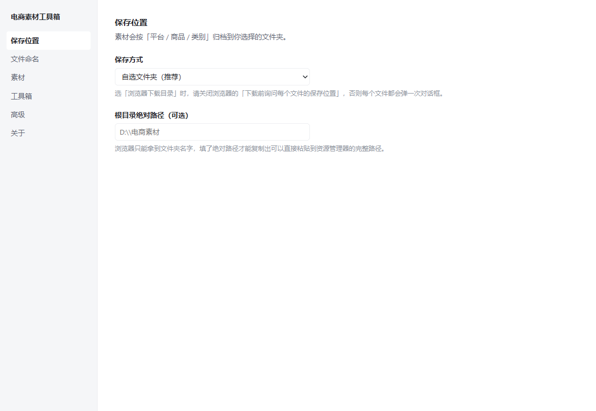
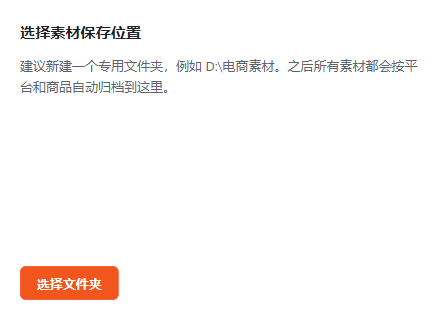

# 安装说明

## 已经装好了

| 项 | 值 |
| --- | --- |
| 扩展位置 | `D:\Tools\EcBox` |
| 扩展 ID | `jncbfkkbkknlcaegfjlkphohpefbpkmn` |
| 浏览器 | Chrome（独立 profile：`D:\EcomKit\.phase0-raw\ecbox-profile`） |
| 设置页 | `chrome-extension://jncbfkkbkknlcaegfjlkphohpefbpkmn/options.html` |

打开方式：**直接运行下面的命令**，会用同一个 profile 启动 Chrome，扩展还在。

```powershell
node scripts/install-extension.mjs chrome --keep-open
```

---

## 为什么不能按老办法拖进去

Chrome 137 起移除了 `--load-extension` 命令行开关（安全策略），Playwright 也装不进去了。
本脚本用的是 DevTools Protocol 在 **browser target** 上的 `Extensions.loadUnpacked`，
配合 `--enable-unsafe-extension-debugging` 启动参数 —— 这是官方给自动化测试留的口子。

> 注意：`Extensions.loadUnpacked` 必须在 **browser target** 上调用。
> 在 page target 上调会报 `Method not available`。

---

## 装进你日常使用的 Chrome

上面的安装用的是独立 profile（不影响你日常的浏览器数据，也最安全）。
如果想装进日常 profile，让它出现在你平时用的那个 Chrome 里：

1. **完全退出 Chrome**（任务栏右键 → 退出，确认任务管理器里没有 chrome.exe）
2. 运行：

```powershell
node scripts/install-extension.mjs chrome --profile "C:\Users\<你的用户名>\AppData\Local\Google\Chrome\User Data"
```

3. 装完打开 `chrome://extensions`，确认「电商素材工具箱」在列表里
4. 把它固定到工具栏（拼图图标 → 图钉）

### 或者完全手动（不用脚本）

1. Chrome 地址栏输入 `chrome://extensions`
2. 右上角打开「开发者模式」
3. 点「加载已解压的扩展程序」
4. 选 `D:\Tools\EcBox` 文件夹

手动加载也**不会**改变扩展 ID —— 因为 `manifest.json` 里写死了 `key` 字段。

---

## Edge

```powershell
node scripts/install-extension.mjs edge --keep-open
```

Edge 目前还保留 `--load-extension` 兼容路径，两种方式都行。
装完 Edge 可能提示「关闭开发人员模式扩展」，点「保留」即可。

---

## 更新扩展

改完代码后：

```powershell
bun run build                 # 重新构建
node scripts/install-extension.mjs chrome --keep-open
```

或者手动：重新构建 → 把 `.output/chrome-mv3/*` 覆盖到 `D:\Tools\EcBox` → 在 `chrome://extensions` 点刷新按钮。

**扩展 ID 不变**，所以设置、目录授权、商品文件夹索引都会保留。

---

## 密钥（重要）

| 文件 | 位置 | 是否入库 |
| --- | --- | --- |
| 私钥 | `D:\EcomKit\keys\private-key.pem` | ❌ 绝不入库 |
| 公钥 | `D:\EcomKit\keys\public-key.b64` | ✅ 已入库 |
| 扩展 ID | `D:\EcomKit\keys\extension-id.txt` | ❌ 本地保留 |

**私钥请自己另外备份一份。** 它丢了就得重新生成，扩展 ID 会变，
用户的设置和目录授权会全部失效（方案 §14）。

---

## 装完先做这三件事

1. 打开设置页，确认「保存方式」和「根目录绝对路径」（填了才能复制完整路径）
2. 打开一个拼多多商品页 —— **未登录会跳登录页，这是平台行为**，先登录再刷新
3. 第一次点下载会弹授权小窗，选一个专用文件夹（例如 `D:\电商素材`），
   在系统权限提示里选「每次访问时允许」，以后就不会再问

抖音商城详情页在电脑上只显示扫码页，这是平台限制（Phase 0 实测，改 UA 无效），
扩展会显示「抖音限制了电脑端查看」。

---

## 界面





